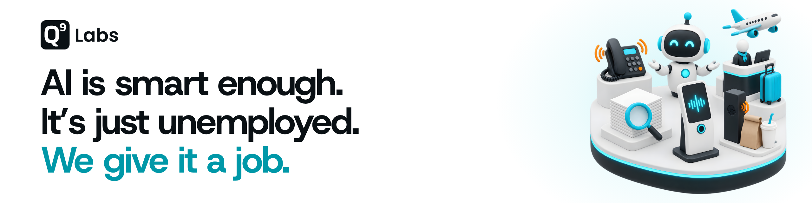

# Q9 Labs

We build AI that does one complete job inside a business, like answering the phone or interviewing applicants, and we plug it into the systems the business already runs on. The AI does the work and a person approves what matters. We're a small team in Dubai, and our products are in production with paying customers.

## The jobs

- **[Ava](https://q9labs.ai/products/ava)** takes the phone. It answers and makes calls, books appointments, and updates your CRM
- **[Nura](https://q9labs.ai/products/nura)** takes the interview. Every applicant gets one, and you read the shortlist
- **[Mesa](https://mesa.q9labs.ai)** takes the order, at the drive-through, on the phone, or at the table
- **[Terminal](https://terminal.q9labs.ai)** takes the help desk at airports, in whatever language the traveller speaks
- **[Track](https://track.q9labs.ai)** takes the project: chat, tasks, and an AI that only sees what you're allowed to see
- **[Murmur](https://murmur.q9labs.ai)** takes the translation at live talks, so the room reads along in its own language
- **[Flow](https://q9labs.ai/products/flow)** takes the form. People talk instead of typing, then check the record before it's sent
- **[Edli](https://q9labs.ai/products/edli)** takes the school office: admin, academics, and parent messages in one platform

## Open source

- **[Chalk](https://github.com/Q9Labs/chalk)**: Real-time collaboration SDK for calls and whiteboards, on React and React Native
- **[q9stack](https://github.com/Q9Labs/q9stack)**: The TypeScript toolkit and quality gates every Q9 app ships on

## Say hi

[q9labs.ai](https://q9labs.ai) · [X](https://x.com/q9labsai) · [LinkedIn](https://linkedin.com/company/q9labs) · [hello@q9labs.ai](mailto:hello@q9labs.ai)
